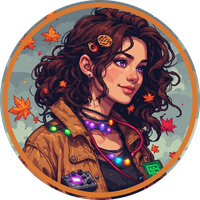
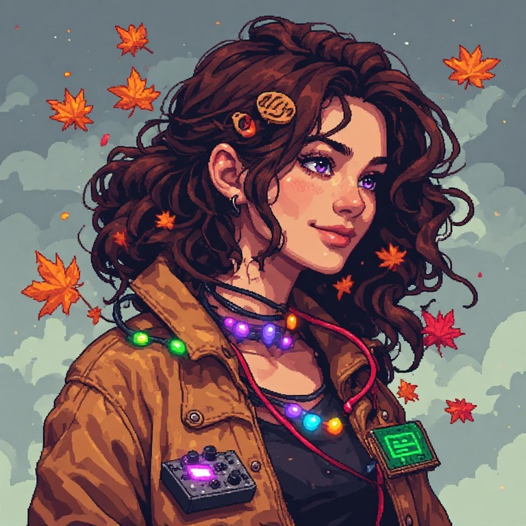

<p align="center"></p>

[](https://x.com/NorowaretaGemu)
[](https://opensource.org/licenses/MIT)
  
<br>
<div align="center">
  <a href="https://ko-fi.com/cursedentertainment">
    
  </a>
</div>
<div align="center">
  
  
</div>
<div align="center">
  
  
</div>
<div align="center">
  
</div>

# NIKA
## The robot that thinks in square waves

- Robot Type: Tracked robot (UNO + WiFi R3, like [MILA](https://github.com/CursedPrograms/MILA-Robot-v00))

<div align="center">
  
  <p><i>NIKA</i></p>
</div>

NIKA is MILA's sister: the same board, tracks, modes, remote and fleet link, with a 16-LED RGB array, a small OLED, an infrared obstacle sensor and a synthesizer for a brain. Her drives are oscillators, and the loudest one is her thought: you can hear her think.

---

## Related Projects

- [MILA-Robot-v00](https://github.com/CursedPrograms/MILA-Robot-v00)
- [NORA-Robot-v00](https://github.com/CursedPrograms/NORA-Robot-v00)
- [RIFT](https://github.com/CursedPrograms/RIFT)
- [RITA](https://github.com/CursedPrograms/RITA)
- [DREAM](https://github.com/CursedPrograms/DREAM)

---

## 📖 Overview

<details open>
<summary><b>Overview</b></summary>

### The synth brain: she thinks in square waves
Four drives, each a square-wave frequency that follows what she senses. The highest one is her thought.

| Drive | Frequency | What moves it |
| :--- | :--- | :--- |
| **calm** | 196 Hz (G3) | always there, the hum underneath |
| **curious** | 220 to 660 Hz | rises the longer the way ahead stays open (over 30 s), and starts again low after something gets close |
| **caution** | 220 to 880 Hz | rises as something gets close (60 cm to 5 cm), 880 Hz when the IR sensor sees something |
| **social** | 523 Hz (C5), falling over 10 s | she heard NORA (her talk or "I'm here" beacon over the IR link): someone's near |

Her thought is heard, seen and acted on:
- **Heard**: the synthesizer plays it. A digital potentiometer (MCP41010) sits where the kit's frequency pot was, so NIKA sets its pitch. With the kit's square-wave jumper, it's a square wave.
- **Seen**: her 16 LEDs show its colour while she drives (calm teal, curious violet, caution orange, social pink), and the OLED its name and Hz.
- **Acted on**: exploring by herself (obstacle mode), it sets her speed: curious 100%, calm 80%, social 55% with a hello beep, caution 45%.
- Her dashboard and controller show it (THINKS, HZ), and RIFT sees it in her `/status` (`thought`, `hz`).

### What she shares with MILA
- [x] WASD, TANK and OBSTACLE modes, the IR remote, NORA's IR fleet link (address `0x0DA5`), the drive PIN, Brainfuck talk, `SCAN`.
- [x] The wall guard when you drive her, and ticks faster as a wall gets close.
- [x] The fleet's WiFi ladder (the very bottom, below MILA), her own `NIKA` AP when she's alone, the dashboard on `:5013`, the imposter radar, ESP-NOW beacons. Everyone makes way for her: like MILA's, her ESP8266 can't hear them.
- [x] **MIND mode** (from MILA's): the LLM on her PC controller drives her one short move at a time, and her synth brain's thought (and its Hz) is one of the things it senses, so it knows how she feels. **M** on the Python controller, or MIND on her dashboard while it's connected (x86 PC, 8 GB+ RAM, GTX 1050 or better). Her voice: Zira, extra high.

</details>

---

## Prerequisites

<details>
<summary><b>Hardware</b></summary>

| Part | Notes |
| :--- | :--- |
| **UNO + WiFi R3** board (ATmega328P + ESP8266) | The same board as MILA, with its DIP switches |
| **L298N** motor driver + wooden tank chassis (like IDA's) | ENA / ENB on PWM pins 5 and 6 |
| **HC-SR04** on a **servo** | Looks ahead and to both diagonals |
| **IR obstacle sensor** (FC-51 style) | Only on/off: LOW when something is within the range set by its pot |
| **16-LED RGB array** (WS2812) | Brightness capped in code so it doesn't overload the board |
| **SSD1306 128x32 OLED**, SPI | The one from [spi_screen_test](https://github.com/CursedPrograms/spi_screen_test) |
| **Synthesizer kit** (XR2206-style function generator) | Square-wave jumper on; its frequency pot replaced by an **MCP41010** digital pot (10 kΩ) |
| IR remote + receiver, buzzer | |

</details>

<details>
<summary><b>Software</b></summary>

| Sketch | Board (Tools > Board) | Needs |
| :--- | :--- | :--- |
| `scripts/NIKA` | Arduino UNO | Libraries: **IRremote** (4.x), **Servo**, **Adafruit NeoPixel**, **SSD1306Ascii** |
| `scripts/esp8266` | Generic ESP8266 Module (Flash Size 4MB, FS 2MB OTA) | The **esp8266** boards: add `https://arduino.esp8266.com/stable/package_esp8266com_index.json` under File > Preferences > Additional boards manager URLs |

The Python controller: `pip install -r requirements.txt` (pygame, requests), or `run.bat` / `run.sh`.

</details>

---

## ⚡ Technical Pinouts

<details open>
<summary><b>UNO pins (a first plan: change the numbers at the top of NIKA.ino to match the wiring)</b></summary>

| Pin | Part | Pin | Part |
| :--- | :--- | :--- | :--- |
| D0 / D1 | ESP8266 serial (DIP 1 + 2) | D8 | Buzzer |
| D2 / D3 | HC-SR04 TRIG / ECHO | D9 / D10 | OLED DC / CS |
| D4, D7, **D5** | L298N IN1, IN2, **ENA** (right) | D11 / D13 | OLED MOSI (SDA) / SCK (SCL), and the digital pot's |
| A2, A4, **D6** | L298N IN3, IN4, **ENB** (left) | D12 | IR obstacle sensor OUT |
| A0 | RGB array data | A1 | Servo |
| A3 | IR remote receiver | A5 | Digital pot CS |
| OLED RST | the board's RESET pin | | |

Why: ENA and ENB need PWM, and on an UNO the Servo library takes Timer1 (no PWM on 9 and 10) and the buzzer and IR receiver take Timer2 (3 and 11). Pins 5 and 6 are the only PWM pins left, so the RGB array, which needs no PWM, is on A0.

</details>

---

## 🌐 Connectivity & Controls

<details>
<summary><b>Controls</b></summary>

### Controls
<!-- keymap:start -->
<!-- generated by keymap.py --readme; edit the list there -->

**Keyboard: web page and every desktop controller**

| Key | Does |
|---|---|
| 1 / 2 / 3 | WASD / TANK / OBSTACLE mode |
| W / Up, S / Down | forward / back (WASD mode, hold) |
| A / Left, D / Right | turn left / right (WASD mode, hold) |
| Q / A | left track forward / back (TANK mode, hold) |
| E / D | right track forward / back (TANK mode, hold) |
| Space | stop (controllers) |
| M | her MIND mode on / off: the LLM on this PC drives her (Python controller; x86 PC, GTX 1050+) |
| X | speed preset: 100, 75, 50, 25 % (web page) |
| F1 | this window (Python controller; KEYS on the web page) |
| Esc | quit (controllers) |
| | *driving from the web page needs her PIN first (UNLOCK)* |

**Gamepad or joystick (ARM's flight stick works too)**

| Key | Does |
|---|---|
| Left stick / D-pad | drive (WASD mode) |
| LB / RB, right stick, twist | turn left / right (Python controller) |
| A (button 0) | stop |
| B (1) / X (2) / Y (3) | OBSTACLE / WASD / TANK mode (Python controller) |
| Start (7) | speed + 25 % (Python controller) |
| | *C++, C# and F# controllers: stick or D-pad drive, triggers speed, A stops, bumpers change mode* |

**Her IR remote**

| Key | Does |
|---|---|
| 1 / 2 / 3 | WASD / TANK / OBSTACLE mode |
| Up / Down / Left / Right | drive (WASD mode, hold) |
| Red / Green | left track forward / back (TANK mode) |
| Yellow / Blue | right track forward / back (TANK mode) |
| OK | speed preset: 100, 75, 50, 25 % |

**NORA's IR link (her web page, controller or Bluetooth)**

| Key | Does |
|---|---|
| arrows / I J K L | drive |
| STOP | stop, and out of obstacle mode |
| AUTO / MANUAL | OBSTACLE / WASD mode |
| SPEED | speed preset |
| LOCK / UNLOCK | lock her wheels (nothing drives her) / free them |

<!-- keymap:end -->

</details>

---

## How to Run:
<details open>
<summary><b>View How to Run</b></summary>

1. Copy `scripts/esp8266/secrets.example.h` to `secrets.h` (the fleet's WiFi passwords and her PIN).
2. Flash `scripts/NIKA` to the UNO and `scripts/esp8266` to the ESP8266 with the Arduino IDE, setting the DIP switches for each (as on MILA).
3. Set the synth kit's jumper to square wave and tune `SYNTH_K` in `NIKA.ino` by ear, so each thought's Hz sounds right.
4. Power her on: she joins the fleet's network, or hosts `NIKA`. Open `http://<her IP>:5013/`, or run the controller:

```bash
run.bat                          # Windows
./run.sh                         # Linux / macOS
python scripts/nika_controller.py --host <her IP> --port 5013
```
</details>

---

<br>
<div align="center">
&copy; Cursed Entertainment 2026
</div>
<br>
<div align="center">
<a href="https://cursed-entertainment.itch.io/" target="_blank">
    
</a>
</div>

---

<!-- DREAM-ECOSYSTEM:START -->
## The DREAM Robotics ecosystem

**Minds** — [DREAM](https://github.com/CursedPrograms/DREAM) companion · [TINA](https://github.com/CursedPrograms/TINA) engineer · [NINA](https://github.com/CursedPrograms/NINA) caretaker · [RIFT](https://github.com/CursedPrograms/RIFT) fleet hub · [LYCEA](https://github.com/CursedPrograms/LYCEA) training school  
**Robots** — [NORA](https://github.com/CursedPrograms/NORA-Robot-v00) · [MILA](https://github.com/CursedPrograms/MILA-Robot-v00) · [WHIP](https://github.com/CursedPrograms/WHIP-Robot-v00) · [KIDA-00](https://github.com/CursedPrograms/KIDA-Robot-v00) · [KIDA-01](https://github.com/CursedPrograms/KIDA-Robot-v01) · [IDA](https://github.com/CursedPrograms/IDA-Robot-v00) · [ARM](https://github.com/CursedPrograms/ARM-Robot-v01) · [NIKA](https://github.com/CursedPrograms/NIKA-Robot-v00)  
**Remotes** — [RITA](https://github.com/CursedPrograms/RITA) handheld remote  
**Tools** — [CRUSH](https://github.com/CursedPrograms/CRUSH) compression · [Image-Generator](https://github.com/CursedPrograms/Image-Generator) · [GloriosaAI](https://github.com/CursedPrograms/GloriosaAI) · [SynthWomb](https://github.com/CursedPrograms/SynthWomb) · [PyVitals](https://github.com/CursedPrograms/PyVitals)  
<!-- DREAM-ECOSYSTEM:END -->
